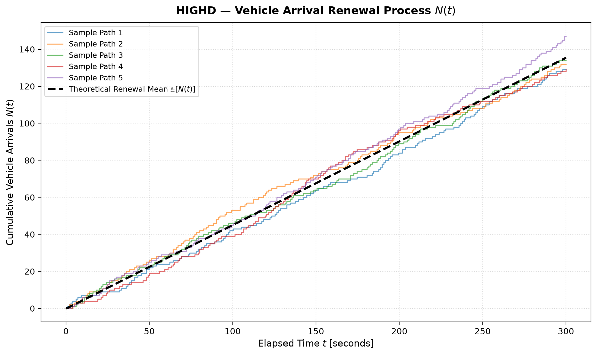
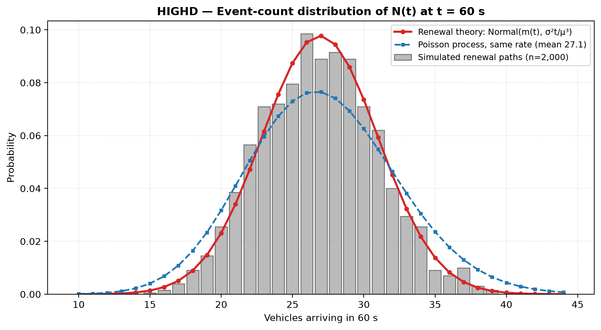
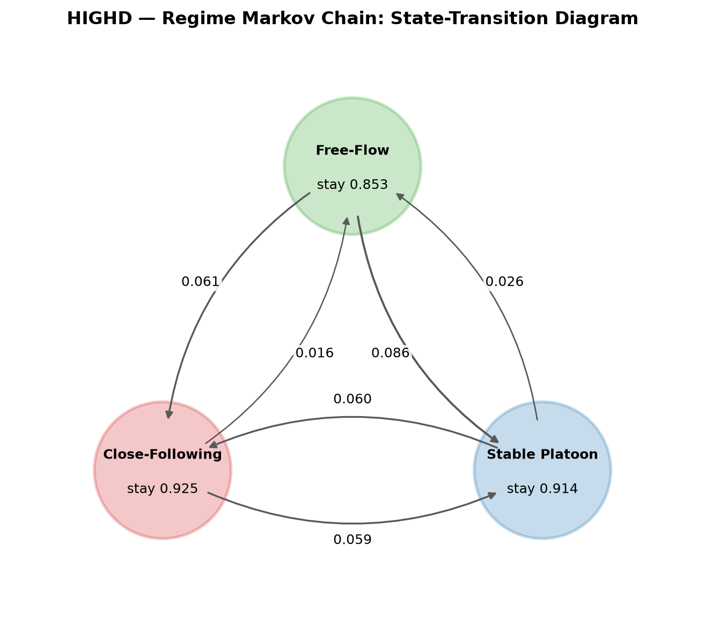
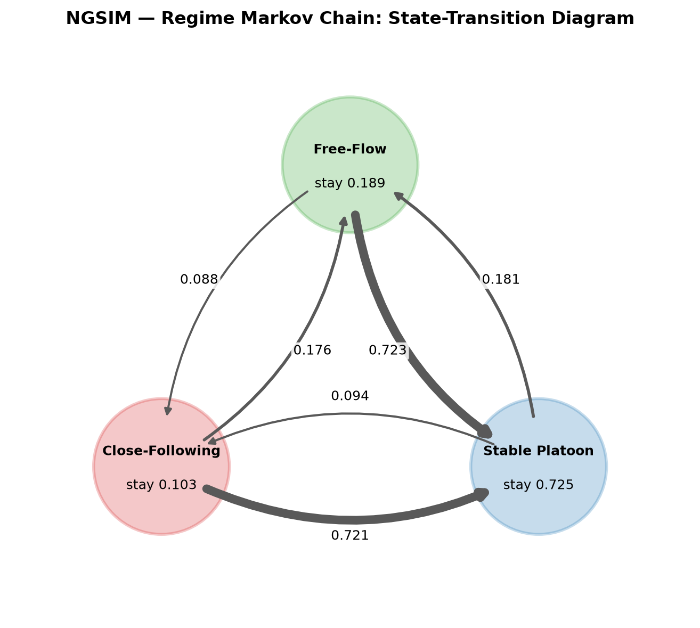
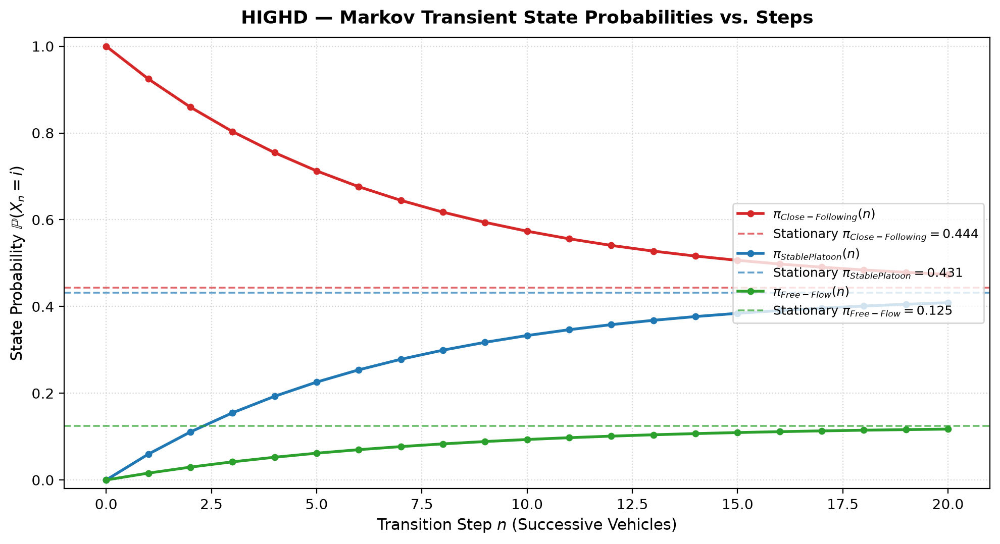
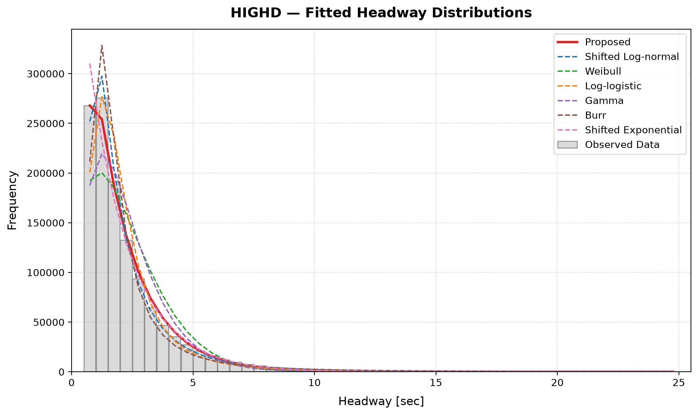
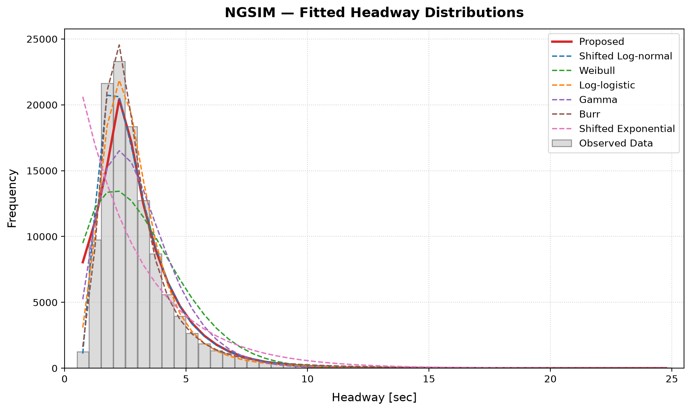
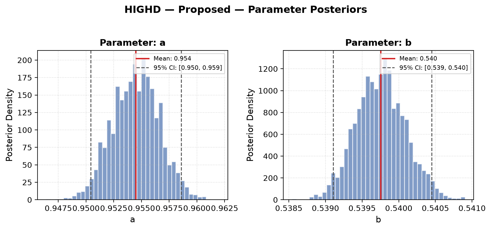
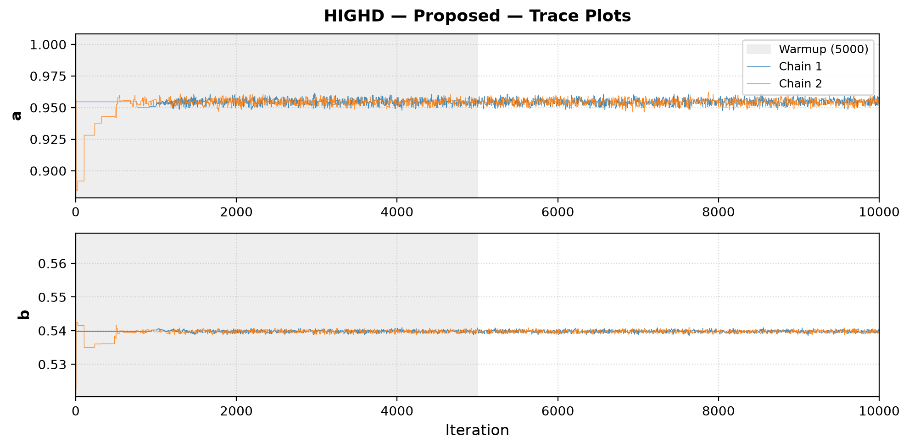

# Abstract {-}

The time gap between successive vehicles in a lane, the *headway*, is a random quantity that governs highway capacity and safety. We study it as a stochastic system on two public trajectory datasets: highD (1,225,460 one-second headway samples from 60 drone recordings of German highways) and NGSIM (117,068 samples from the I-80 data, recording period 1 (the first contiguous recording block)). Three models are built and tested against data. (i) A recently proposed headway density $f(t)\propto b^{|t-a|}$ and six standard distributions are fitted by Bayesian MCMC. (ii) Vehicle arrivals are modelled as a renewal counting process $N(t)$. (iii) Car-following regimes are modelled as a three-state Markov chain. Simulation is compared with theory quantitatively. On highD the proposed distribution ranks 1 of 7 by KL divergence (best: Proposed, 0.0036); on NGSIM it ranks 4 of 7 (best: Burr, 0.0016). Simulated renewal counts agree with theory to within 0.4% in the mean and 11.9% in the variance, and the arrival process is clearly not Poisson (variance-to-mean ratios of 0.61 on highD and 0.46 on NGSIM instead of 1). How well the independent-headway assumption and the first-order Markov assumption hold is quantified in Section 11.

# Introduction

Headway is the key microscopic variable of traffic flow theory. Its reciprocal is the flow of vehicles past a point, short headways raise capacity but reduce safety margins, and its distribution is an input to signal timing, capacity analysis and microscopic simulation. Headways are random: they depend on driver behaviour, vehicle type, speed, traffic volume and road geometry, so no single deterministic value describes a lane. This project follows the pipeline required by the course:

*real-world problem → data → probability model → stochastic process → mathematical analysis → simulation → validation → interpretation.*

The probability model is the headway distribution of Leungbootnak et al. [1]. The stochastic processes built on it are a renewal counting process for vehicle arrivals and a Markov chain for car-following regimes. We implement everything in Python, estimate parameters from real data, simulate multiple sample paths, and compare simulation, theory and data with quantitative measures.

# Problem Statement

**The real-world problem.** Describe the randomness of the gaps between consecutive vehicles on a highway lane, and the random number of vehicles that pass a point in a given time.

**Why randomness is involved.** Each driver chooses a gap depending on perception, reaction time, speed and the vehicle ahead; these choices are heterogeneous and unobserved, so the headway $H$ is a random variable and the arrival count $N(t)$ is a random process.

**Questions we answer.**

1. Which probability distribution describes headways, and does the proposed density $b^{|t-a|}$ outperform six standard alternatives (shifted log-normal, Weibull, log-logistic, gamma, Burr, shifted exponential)?
2. Is vehicle arrival well described by a Poisson process, or by a more general renewal process? How well does simulation agree with renewal theory?
3. Do car-following regimes (close following, platoon, free flow) evolve as a Markov chain, and what is its long-run behaviour?
4. How closely do we reproduce the results published for the proposed distribution [1]?

# Literature Review

Headway modelling began with Adams, who treated road traffic as a random series and used the negative exponential distribution, which corresponds to Poisson arrivals [2]. Because the exponential law allows arbitrarily short headways, shifted and composite forms were introduced later, including the shifted exponential, log-normal, hyper-exponential and Pearson type III distributions. Cowan [3] separated a *tracking* component (vehicles following closely) from a *free* component, giving the M1 to M4 family of composite models. Later studies showed that headway depends on speed [4] and on vehicle type [5] and that no single standard distribution fits all conditions: log-normal and log-logistic fits are favoured in different flow states, and gamma for some vehicle pairs, as reviewed in [1]. Mixture and Bayesian model-averaging approaches [6] fit well but are expensive to estimate. Leungbootnak et al. [1] instead modify the exponential function to $b^{|t-a|}$ with a free base, giving a two-parameter unimodal density with interpretable parameters, estimated by MCMC. The stochastic-process tools we use are classical: renewal theory [7, 8] for the arrival count, and finite Markov chains [9] for the regime sequence.

# Data Description

Both datasets are public trajectory collections. **highD** [10] contains drone recordings of German highways at 25 Hz, in 60 recordings; for each vehicle it reports the preceding vehicle (`precedingId`) and the time headway to it (`thw`). **NGSIM** [11] is the FHWA Next Generation Simulation program; we use the I-80 data (Emeryville, California), recorded at 10 Hz by cameras, with the preceding vehicle and `Time_Headway` per record. We use the original Data.gov export, not the reconstructed trajectories that the paper cites [1].

Following the paper, we keep one sample per second per following vehicle, keep only vehicles that have a leader, and discard headways below 0.5 s (below human reaction time) and above 25 s (not car following). For NGSIM we use the I-80 data, recording period 1 (the first contiguous recording block). The paper does not say which NGSIM recording period it used. Of the two periods in the export, we chose the one whose mean headway and sample size are consistent with the values implied by the paper's fitted parameters (a mean of about 2.9 s); this is an inference, not something the paper states.

| Dataset | Selection | Samples | Mean (s) | Median (s) | Std (s) |
|---|---|---|---|---|---|
| highD | all 60 recordings | 1,225,460 | 2.21 | 1.66 | 1.73 |
| NGSIM | the I-80 data, recording period 1 (the first contiguous recording block) | 117,068 | 3.08 | 2.56 | 2.08 |

Table: **Table 1.** Headway samples used (one per second per follower, 0.5 to 25 s).

# Mathematical Background

**Renewal theory.** Let $H_1,H_2,\dots$ be i.i.d. positive random variables with mean $\mu$ and variance $\sigma^2$, and $S_n=H_1+\dots+H_n$. The counting process $N(t)=\max\{n:S_n\le t\}$ is a *renewal process*; $\{N(t)\ge n\}=\{S_n\le t\}$. The renewal function $m(t)=\mathbb E[N(t)]$ satisfies $m(t)/t\to 1/\mu$ (elementary renewal theorem), and for a non-lattice distribution with finite variance

$$m(t)=\frac{t}{\mu}+\frac{\sigma^{2}-\mu^{2}}{2\mu^{2}}+o(1),\qquad \operatorname{Var}N(t)\sim\frac{\sigma^{2}t}{\mu^{3}},\qquad N(t)\ \dot\sim\ \mathcal N\!\Big(\frac{t}{\mu},\frac{\sigma^{2}t}{\mu^{3}}\Big).$$

If $H$ is exponential, $N(t)$ is a Poisson process: $\operatorname{Var}N(t)=\mathbb E N(t)=t/\mu$. In general $\operatorname{Var}N(t)/\mathbb E N(t)\to\sigma^2/\mu^2$, the squared coefficient of variation of the headway. Values below 1 mean arrivals are more regular than Poisson.

**Markov chains.** A discrete-time Markov chain on a finite state space with transition matrix $P=(p_{ij})$ satisfies the Chapman-Kolmogorov equation $P^{(n)}=P^{n}$. If the chain is irreducible and aperiodic, $P^{n}\to \mathbf 1\pi$ where the stationary distribution solves $\pi P=\pi,\ \sum_i\pi_i=1$, and the mean recurrence time of state $i$ is $1/\pi_i$. The maximum-likelihood estimate from an observed path is $\hat p_{ij}=n_{ij}/n_{i\cdot}$.

**Bayesian estimation.** For parameters $\theta$ with prior $p(\theta)$, the posterior is $p(\theta\mid x)\propto p(x\mid\theta)p(\theta)$. The Metropolis-Hastings algorithm draws a candidate $\theta'=\theta+\varepsilon$, $\varepsilon\sim\mathcal N(0,s^2\Sigma)$, and accepts it with probability $\min\{1,p(\theta'\mid x)/p(\theta\mid x)\}$. Convergence is checked with the split $\hat R$ statistic across chains [12].

**Goodness-of-fit measures** (paper, Sections 3.4-3.5): the Kolmogorov-Smirnov statistic, the chi-square statistic with bins merged until the observed count is at least 5, the Kullback-Leibler divergence $D_{KL}(P\|Q)=\sum_k p_k\log(p_k/q_k)$ between the observed and model bin probabilities, and a Wasserstein distance (Eq. 17 of [1]).

# Stochastic Model

| Component | Random variable | State space | Time parameter | Model |
|---|---|---|---|---|
| Headway | $H_i$ | $[0.5,\infty)$ s | vehicle index $i$ | i.i.d., density $b^{\lvert t-a\rvert}/Z$ |
| Arrival count | $N(t)$ | $\{0,1,2,\dots\}$ | continuous, $t\ge0$ | renewal process with inter-arrival times $H_i$ |
| Car-following regime | $X_n$ | {close, platoon, free} | discrete, 1 s steps | first-order Markov chain, matrix $P$ |

Table: **Table 2.** Random variables, state spaces and time parameters.

## The headway distribution

The proposed density is $f(t\mid a,b)=b^{|t-a|}/Z$ on $t\ge\alpha=0.5$ s, with mode $a$ and dispersion $0<b<1$. Writing $\kappa=-\ln b>0$, it is $f\propto e^{-\kappa|t-a|}$: a Laplace density truncated to $t\ge\alpha$, with $b$ controlling the decay. For $a\ge\alpha$ the normalising constant, obtained by integrating separately on $[\alpha,a]$ and $[a,\infty)$, is $Z=(2-b^{a-\alpha})/\kappa$ and the distribution function is

$$F(t)=\begin{cases}\dfrac{b^{a-t}-b^{a-\alpha}}{2-b^{a-\alpha}}, & \alpha\le t\le a,\\[2ex]\dfrac{2-b^{a-\alpha}-b^{t-a}}{2-b^{a-\alpha}}, & t\ge a.\end{cases}$$

This agrees with the closed form in [1] and is verified against numerical integration in our test suite. It also gives an inverse-transform sampler: with $c=b^{a-\alpha}$ and $u\sim U(0,1)$, $t=a-\ln(u(2-c)+c)/\ln b$ if $u\le F(a)$, otherwise $t=a+\ln((1-u)(2-c))/\ln b$.

## The arrival process and the regime chain

*Arrivals.* Successive headways $H_i$ are modelled as i.i.d. draws from the headway distribution; the number of vehicles that have passed a detector by time $t$ is the renewal process $N(t)$ of Section 5, with state space $\{0,1,2,\dots\}$ and continuous time. The assumptions are: one lane, stationary traffic, and independent headways. *Regimes.* Each one-second sample of a following vehicle is assigned a regime $X_n\in\{\text{Close following}\ (0.5\le h<1.5\text{ s}),\ \text{Stable platoon}\ (1.5\le h<4\text{ s}),\ \text{Free flow}\ (h\ge4\text{ s})\}$. The sequence $(X_n)$ is modelled as a time-homogeneous, first-order Markov chain with discrete time (one step is one second of one vehicle's trajectory). The regime boundaries are modelling choices, not estimated quantities.

# Methodology

1. **Data.** Load the datasets, sample at 1 Hz, keep vehicles with a leader, and keep headways in $[0.5,25]$ s.
2. **Estimation.** For each of the seven distributions, run two Metropolis-Hastings chains of 10,000 iterations (5,000 warmup) with the priors of [1]; the estimate is the posterior mean. The likelihood uses the counts in 49 bins of width 0.5 s, $\log L=\sum_k n_k\log p_k(\theta)$, which makes each step cost independent of the sample size.
3. **Goodness of fit.** KS, chi-square, KL divergence and Wasserstein distance between the observed and fitted bin probabilities.
4. **Stochastic processes.** Estimate $P$ by transition counts; compute $P^n$, $\pi$ and recurrence times; simulate renewal paths and Markov paths.
5. **Validation.** (a) Simulated $N(t)$ against renewal theory (mean, variance and distribution at $t=30,60,120,300$ s from 2,000 simulated paths); (b) autocorrelation of the headway sequence, to test the independence assumption; (c) Chapman-Kolmogorov check of $P^n$ against empirical $n$-step frequencies, stationary distribution against observed regime fractions, and a likelihood-ratio test of first against second order; (d) our results against those published in [1].

# Computational Implementation

All code is our own Python (NumPy, SciPy, pandas, Matplotlib); the Metropolis-Hastings sampler is written from scratch. The package `headway/` is organised by role: `distributions.py` (the seven distributions, their CDFs and priors), `mcmc.py` and `fit.py` (sampler and posterior), `metrics.py` (goodness of fit), `datasets/` (highD and NGSIM loaders), `stochastic_process.py` (renewal process and Markov chain), `validation.py` (the quantitative checks above), `simulation.py` and `plots.py`. `run.py` executes the full pipeline and writes CSV tables and figures; a pytest suite covers the distributions, sampler, loaders, metrics and stochastic processes. Independent chains and independent recordings run in parallel on all CPU cores. The complete benchmark is reproduced by `uv run python run.py --period 1 --real-only`, with seed 42; MCMC for all seven distributions took 1.8 s on highD and 1.7 s on NGSIM.

# Simulation Results

## Renewal arrival process

Figure 1 shows five simulated sample paths of $N(t)$ with the renewal function $m(t)$ for highD. Headways were resampled i.i.d. from each dataset, so these are realisations of the model of Section 6. Table 3 compares 2,000 simulated paths with renewal theory.

{width=65%}

| Dataset | $t$ (s) | E[N] sim | E[N] theory | Var[N] sim | Var[N] theory | Var if Poisson | mean err | var err |
|---|---|---|---|---|---|---|---|---|
| highD | 60 | 26.86 | 26.93 | 16.86 | 16.56 | 27.12 | 0.23% | 1.8% |
| NGSIM | 60 | 19.15 | 19.18 | 8.54 | 8.86 | 19.45 | 0.16% | 3.6% |
| highD | 300 | 135.57 | 135.41 | 85.94 | 82.81 | 135.60 | 0.12% | 3.8% |
| NGSIM | 300 | 96.99 | 96.98 | 44.85 | 44.28 | 97.26 | 0.00% | 1.3% |

Table: **Table 3.** Simulated renewal counts (2,000 paths) against renewal theory.

On highD the simulated mean and variance of $N(t)$ at $t=300$ s are 135.6 and 85.9, against theoretical values of 135.4 and 82.8. A Poisson process with the same rate would have a variance of 135.6. On NGSIM the corresponding values are 97.0 and 44.8 against 97.0 and 44.3 (Poisson: 97.3). The arrival process is therefore sub-Poisson (variance-to-mean ratio 0.61) on highD and sub-Poisson (variance-to-mean ratio 0.46) on NGSIM. Figure 2 shows the full distribution of $N(60)$. At $t=60$ s the largest gap between the simulated and the theoretical count distribution is 0.022 for the renewal-theory normal and 0.071 for a Poisson process on highD, and 0.029 and 0.126 on NGSIM.

{width=60%}

## Regime Markov chain

Figure 3 shows the estimated state-transition diagrams and Table 4 the transition matrices, stationary distributions and mean recurrence times. Figure 4 shows $\pi(n)=\pi(0)P^n$ starting from close following, converging to the stationary distribution.

{width=48%}

{width=48%}

| Dataset | From | to close | to platoon | to free | $\pi_i$ | recurrence $1/\pi_i$ (steps) |
|---|---|---|---|---|---|---|
| highD | Close following | 0.925 | 0.059 | 0.016 | 0.444 | 2.25 |
|  | Stable platoon | 0.060 | 0.914 | 0.026 | 0.431 | 2.32 |
|  | Free flow | 0.061 | 0.086 | 0.853 | 0.125 | 7.99 |
| NGSIM | Close following | 0.103 | 0.721 | 0.176 | 0.094 | 10.66 |
|  | Stable platoon | 0.094 | 0.725 | 0.181 | 0.724 | 1.38 |
|  | Free flow | 0.088 | 0.723 | 0.189 | 0.182 | 5.49 |

Table: **Table 4.** Estimated transition matrices, stationary distributions and mean recurrence times.

{width=60%}

# Real Data Results

Table 5 lists the posterior-mean parameters next to the published values [1]; Tables 6 and 7 give the KL divergence and Wasserstein distance. Figure 5 overlays the fitted densities on the observed histograms.

| Distribution | highD ours | highD paper | NGSIM ours | NGSIM paper |
|---|---|---|---|---|
| Proposed | a=0.954, b=0.540 | a=0.936, b=0.540 | a=2.336, b=0.524 | a=2.277, b=0.481 |
| Shifted Log-normal | μ=0.179, σ=0.921, γ=0.438 | μ=0.233, σ=0.899, γ=0.377 | μ=0.748, σ=0.614, γ=0.500 | μ=0.683, σ=0.594, γ=0.528 |
| Weibull | α=1.450, β=2.472 | α=1.481, β=2.473 | α=1.678, β=3.485 | α=1.744, β=3.305 |
| Log-logistic | α=2.618, β=1.717 | α=2.574, β=1.719 | α=3.664, β=2.617 | α=3.910, β=2.515 |
| Gamma | α=2.304, β=1.038 | α=2.335, β=1.055 | α=3.693, β=1.196 | α=4.175, β=1.428 |
| Burr | α=3.777, β=0.468, λ=1.168 | α=3.199, β=0.602, λ=1.296 | α=4.896, β=0.533, λ=2.086 | α=5.237, β=0.524, λ=2.021 |
| Shifted Exponential | λ=0.584, γ=0.500 | λ=0.584, γ=0.500 | λ=0.387, γ=0.500 | λ=0.423, γ=0.558 |

Table: **Table 5.** Posterior-mean parameters against the paper's Table 3.

| Distribution | highD ours | highD paper | NGSIM ours | NGSIM paper |
|---|---|---|---|---|
| Proposed | 0.0036 | 0.0032 | 0.0760 | 0.0805 |
| Shifted Log-normal | 0.0063 | 0.0111 | 0.0153 | 0.0157 |
| Weibull | 0.0586 | 0.0534 | 0.1944 | 0.2098 |
| Log-logistic | 0.0229 | 0.0287 | 0.0168 | 0.0173 |
| Gamma | 0.0498 | 0.0454 | 0.1150 | 0.1182 |
| Burr | 0.0288 | 0.0332 | 0.0016 | 0.0027 |
| Shifted Exponential | 0.0080 | 0.0065 | 0.2713 | 0.3024 |

Table: **Table 6.** KL divergence (lower is better) against the paper's Table 5.

| Distribution | highD ours | highD paper | NGSIM ours | NGSIM paper |
|---|---|---|---|---|
| Proposed | 0.0012 | 0.0011 | 0.0043 | 0.0040 |
| Shifted Log-normal | 0.0015 | 0.0016 | 0.0022 | 0.0021 |
| Weibull | 0.0058 | 0.0052 | 0.0090 | 0.0088 |
| Log-logistic | 0.0022 | 0.0026 | 0.0020 | 0.0020 |
| Gamma | 0.0050 | 0.0049 | 0.0063 | 0.0173 |
| Burr | 0.0033 | 0.0032 | 0.0009 | 0.0011 |
| Shifted Exponential | 0.0021 | 0.0018 | 0.0050 | 0.0047 |

Table: **Table 7.** Wasserstein distance (Eq. 17, lower is better) against the paper's Table 5.

{width=62%}

{width=62%}

On highD, the proposed distribution has a mode $a=$ 0.954 s (paper: 0.936) and $b=$ 0.540 (paper: 0.540), i.e. a decay rate $\kappa=$ 0.617 per second. On NGSIM, $a=$ 2.336 s (paper: 2.277), $b=$ 0.524 (paper: 0.481), $\kappa=$ 0.646. The KS and chi-square tests reject every fitted distribution at the 5% level. With samples of this size even small deviations are statistically significant, so KL divergence and Wasserstein distance are the more informative measures (Appendix, Table A1). The posterior and trace plots for the proposed distribution are in Appendix, Figure A1.

# Model Validation

**Against the published results.** Our KL divergences differ from Table 5 of the paper by at most 0.0058 (Log-logistic) on highD and 0.0311 (Shifted Exponential) on NGSIM (Table 6). The best model by KL is Proposed on highD in our run (paper: Proposed) and Burr on NGSIM (paper: Burr). The Wasserstein values (Table 7) follow our reading of Eq. 17 (Section 13) and are on the paper's scale; the largest difference is 0.0006 (Weibull) on highD and 0.0110 (Gamma) on NGSIM. The KL of badly fitting baselines is sensitive to the exact sample, which differs from the paper's NGSIM sample (Section 13). The paper's Wasserstein value for Gamma on NGSIM (0.0173) is also inconsistent with its own KL ranking, so we do not expect to reproduce it.

**MCMC convergence.** The largest split $\hat R$ is 4.917 (highD) and 1.011 (NGSIM), with acceptance rates between 19% and 26% (the optimum for random-walk Metropolis is about 23%; Appendix, Table A2). Chains did not converge (split R-hat of at least 1.05) for highD: Shifted Exponential (R-hat 4.92). We did not investigate this further, so the point estimates for these fits are less reliable.

**Renewal process against theory.** Simulated means and variances of $N(t)$ agree with renewal theory within 0.4% and 11.9% (Table 3), so the simulation reproduces the theory to that accuracy. Whether the *model* matches the data is a separate question: the headway sequence has lag-1 autocorrelation 0.839 on highD and 0.014 on NGSIM, against a 95% white-noise band of $\pm$0.0018 and $\pm$0.0057, so the data show strong serial dependence between successive headways (the i.i.d. assumption of the renewal model does not hold at the one-second sampling scale) on highD and weak but statistically significant serial dependence on NGSIM (Appendix, Table A3).

**Markov chain.** Table 8 summarises the checks. On highD, the largest gap between the empirical two-step transition matrix and $P^2$ is 0.008 (0.048 at five steps); the stationary distribution differs from the observed regime fractions by a total-variation distance of 0.0000; a simulated long path reproduces $\pi$ (distance 0.0032). The likelihood-ratio test of first against second order gives p = 2.7e-245 with an average effect size (total variation between $P(\cdot\mid i,j)$ and $P(\cdot\mid j)$) of 0.004, so the first-order assumption is rejected statistically, but the extra dependence on the second-previous regime is small. On NGSIM, the largest gap between the empirical two-step transition matrix and $P^2$ is 0.012 (0.008 at five steps); the stationary distribution differs from the observed regime fractions by a total-variation distance of 0.0000; a simulated long path reproduces $\pi$ (distance 0.0013). The likelihood-ratio test of first against second order gives p = 2.9e-04 with an average effect size (total variation between $P(\cdot\mid i,j)$ and $P(\cdot\mid j)$) of 0.005, so the first-order assumption is rejected statistically, but the extra dependence on the second-previous regime is small.

| Check | highD | NGSIM |
|---|---|---|
| Lag-1 autocorrelation of headways (95% band) | 0.839 (±0.0018) | 0.014 (±0.0057) |
| Chapman-Kolmogorov, 2-step, max error | 0.008 | 0.012 |
| Chapman-Kolmogorov, 5-step, max error | 0.048 | 0.008 |
| Stationary vs observed regime fractions (TV) | 0.0000 | 0.0000 |
| Simulated path vs $\pi$ (TV) | 0.0032 | 0.0013 |
| First- vs second-order test, p-value | 2.7e-245 | 2.9e-04 |
| Second-order effect size (TV) | 0.004 | 0.005 |

Table: **Table 8.** Validation of the independence and Markov assumptions.

# Discussion

*Traffic interpretation.* The renewal rate $1/\mathbb E[H]$ is the lane flow: 1,627 veh/h/lane on highD (mean headway 2.21 s) against 1,167 veh/h/lane on NGSIM (mean headway 3.08 s). The variance-to-mean ratio of the counts is 0.61 on highD and 0.46 on NGSIM (1 for Poisson). Both streams are therefore more regular than Poisson, as expected from car following, which suppresses both very short and very long gaps. The regime chain gives a long-run share of 0.444 / 0.431 / 0.125 (close / platoon / free) on highD against 0.094 / 0.724 / 0.182 on NGSIM, so the dominant regime is close following (44%) on highD and stable platoon (72%) on NGSIM.

*Model comparison.* On highD the proposed distribution ranks 1 of 7 by KL divergence (best: Proposed, 0.0036); on NGSIM it ranks 4 of 7 (best: Burr, 0.0016). The parameters of the proposed distribution are directly interpretable: $a$ is the most frequent headway and $\kappa=-\ln b$ is the exponential decay rate on either side of it.

*Estimation.* Because the likelihood is evaluated on 49 bins, the cost of MCMC does not grow with the sample size; fitting all seven distributions took 1.8 s on highD (1,225,460 samples) and 1.7 s on NGSIM (117,068 samples).

# Limitations

1. **NGSIM sample.** The paper uses the reconstructed I-80 data; we use the original export and our own choice of recording period (Section 4). Some baseline KL values therefore differ from the paper's.
2. **Likelihood.** MCMC uses binned counts rather than every observation, which is exact only to the 0.5 s bin resolution.
3. **Wasserstein distance.** The paper does not define the two vectors in Eq. 17. We compare the sorted observed and model bin probabilities, the only reading that reproduces its magnitudes; this measure ignores where each bin lies on the time axis.
4. **Dependence.** Consecutive one-second samples of one follower are serially dependent, so the i.i.d. renewal assumption and the first-order Markov assumption are approximations, and the sequences contain a few vehicle-to-vehicle jumps (see Section 11).
5. **Chain definition.** One Markov step is one second of one vehicle's trajectory; the regime thresholds (1.5 s and 4 s) are our choice.
6. **Convergence.** Chains did not converge (split R-hat of at least 1.05) for highD: Shifted Exponential (R-hat 4.92). We did not investigate this further, so the point estimates for these fits are less reliable.
7. **Scope.** One lane at a time, no vehicle-type or speed dependence, and only two datasets; the Lyft autonomous-vehicle data used in the paper is not included.

# Conclusion

We modelled highway headways with a fitted probability distribution, a renewal arrival process and a regime Markov chain, estimated all parameters from real data, simulated sample paths, and tested simulation against theory and the models against data. By KL divergence the proposed distribution ranks 1 of 7 on highD and 4 of 7 on NGSIM. This reproduces the qualitative findings of the paper (proposed distribution best on highD, Burr best on NGSIM). In both datasets the arrival process is clearly not Poisson (variance-to-mean ratios of 0.61 on highD and 0.46 on NGSIM instead of 1). Simulation and renewal theory agree closely, and the validation quantifies how well the independence and Markov assumptions hold. Natural extensions are speed-dependent or semi-Markov regime models that capture the observed dependence, a vehicle-type-aware headway distribution, and the mixed human-autonomous traffic of the Lyft dataset.

# References {-}

1. N. Leungbootnak, Z. Li, Z. Wei, D. Lord, Y. Zhang. *Modeling Headway in Heterogeneous and Mixed Traffic Flow: A Statistical Distribution Based on a General Exponential Function.* Texas A&M University (manuscript).
2. W. F. Adams. Road traffic considered as a random series. *J. Institution of Civil Engineers* 4, 1936.
3. R. J. Cowan. Useful headway models. *Transportation Research* 9, 1975.
4. Chen et al.: headway and spacing distributions from NGSIM trajectory data depend on speed (work cited in [1]; see [1] for the full reference).
5. S. P. Hoogendoorn and P. H. L. Bovy: headway models calibrated per vehicle type (work cited in [1]; see [1] for the full reference).
6. Wu et al.: Bayesian model averaging of headway distributions (work cited in [1]; see [1] for the full reference).
7. D. R. Cox. *Renewal Theory.* Methuen, 1962.
8. S. M. Ross. *Stochastic Processes*, 2nd ed. Wiley, 1996.
9. J. R. Norris. *Markov Chains.* Cambridge University Press, 1997.
10. R. Krajewski, J. Bock, L. Kloeker, L. Eckstein. The highD dataset: a drone dataset of naturalistic vehicle trajectories on German highways for validation of highly automated driving systems. *IEEE ITSC*, 2018.
11. U.S. Department of Transportation, FHWA. Next Generation Simulation (NGSIM) vehicle trajectories and supporting data. catalog.data.gov/dataset/next-generation-simulation-ngsim-vehicle-trajectories-and-supporting-data
12. A. Vehtari, A. Gelman, D. Simpson, B. Carpenter, P.-C. Bürkner. Rank-normalization, folding, and localization: an improved $\hat R$ for assessing convergence of MCMC. *Bayesian Analysis* 16(2), 2021.

# Appendix: Code and Additional Tables {-}

## Reproducing the results {-}

```
uv sync
uv run python run.py --period 1 --real-only      # highD + NGSIM, all cores
uv run --group report python -m headway.report   # builds this report from outputs/
uv run pytest -q tests
```

## Key code {-}

The proposed distribution's distribution function (normalised on $[\alpha,\infty)$):

```python
def _proposed_cdf(t, a: float, b: float):
    """Piecewise closed-form CDF on [ALPHA, inf), paper Eq. (2) and Eq. (9)-(13)."""
    if b <= 0.0 or b >= 1.0:
        return np.zeros_like(t, dtype=float)
    t = np.asarray(t, dtype=float)
    out = np.zeros_like(t)
    m = t >= ALPHA
    if not np.any(m):
        return out

    tm = t[m]
    res = np.zeros_like(tm)
    if a > ALPHA:
        denom = b ** (a - ALPHA) - 2.0
        m1 = tm <= a
        res[m1] = (b ** (a - ALPHA) - b ** (a - tm[m1])) / denom
        m2 = ~m1
        res[m2] = (b ** (a - ALPHA) + b ** (tm[m2] - a) - 2.0) / denom
    else:
        res = 1.0 - b ** (tm - ALPHA)

    out[m] = np.clip(res, 0.0, 1.0)
    return out
```

The Metropolis-Hastings sampler:

```python
def metropolis(
    logp: Callable[[np.ndarray], float],
    x0: Sequence[float],
    n_iter: int = 10000,
    n_warmup: int = 5000,
    rng: np.random.Generator = None,
) -> ChainOutput:
    """Run one MCMC chain using adaptive random-walk Metropolis-Hastings.

    Args:
        logp: Log-posterior function theta -> log p(theta | data).
        x0: Initial parameter vector.
        n_iter: Total iterations (warmup + retained).
        n_warmup: Number of warmup/burn-in iterations.
        rng: NumPy random Generator.

    Returns:
        ChainOutput with draws, warmup draws, full history, and acceptance rates.
    """
    if rng is None:
        rng = np.random.default_rng()

    x = np.array(x0, dtype=float)
    d = len(x)
    lp = logp(x)

    # If initial logp is non-finite, attempt small random perturbations to find valid support
    if not np.isfinite(lp):
        for _ in range(50):
            cand = x + 0.05 * rng.standard_normal(d)
            cand_lp = logp(cand)
            if np.isfinite(cand_lp):
                x, lp = cand, cand_lp
                break
        if not np.isfinite(lp):
            raise ValueError(f"Starting point {x0} has non-finite log-posterior {lp}")

    # Initial proposal covariance scaled by Gelman-Roberts-Gilks factor
    cov = np.diag((0.1 * np.maximum(np.abs(x), 0.5)) ** 2)
    L = np.linalg.cholesky(cov)
    scale = 2.38 / np.sqrt(d)

    full_draws = np.empty((n_iter, d), dtype=float)
    acc_window = 0
    acc_warmup_total = 0
    acc_post_total = 0

    window_size = max(50, min(100, n_warmup // 4)) if n_warmup >= 100 else max(10, n_warmup // 2)
    cov_interval = max(100, min(500, n_warmup // 2)) if n_warmup >= 200 else max(20, n_warmup)

    for i in range(n_iter):
        step = scale * (L @ rng.standard_normal(d))
        y = x + step
        lq = logp(y)

        # Metropolis acceptance probability alpha = min(1, exp(lq - lp))
        if np.isfinite(lq) and np.log(rng.random()) < (lq - lp):
            x, lp = y, lq
            acc_window += 1
            if i < n_warmup:
                acc_warmup_total += 1
            else:
                acc_post_total += 1

        full_draws[i] = x

        # Adaptation during warmup only (preserves ergodicity post-warmup)
        if i < n_warmup:
            if (i + 1) % window_size == 0:
                rate = acc_window / float(window_size)
                scale *= float(np.clip(np.exp((rate - 0.234) * 0.8), 0.5, 2.0))
                acc_window = 0

            # Re-estimate proposal covariance structure from empirical warmup trajectory
            if (i + 1) % cov_interval == 0 and i >= window_size:
                history = full_draws[max(0, i - 2 * cov_interval) : i + 1]
                if np.all(history.std(axis=0) > 1e-8):
                    emp_cov = np.cov(history.T)
                    reg_cov = np.atleast_2d(emp_cov) + 1e-8 * np.eye(d)
                    try:
                        L = np.linalg.cholesky(reg_cov)
                    except np.linalg.LinAlgError:
                        pass

    n_post = max(1, n_iter - n_warmup)
    n_warm = max(1, n_warmup)
    post_acc_rate = float(acc_post_total / n_post)
    warm_acc_rate = float(acc_warmup_total / n_warm)

    return ChainOutput(
        draws=full_draws[n_warmup:],
        warmup=full_draws[:n_warmup],
        full_draws=full_draws,
        acceptance_rate=post_acc_rate,
        warmup_acceptance=warm_acc_rate,
    )
```

The renewal-process validation:

```python
def renewal_validation(headways: np.ndarray, times: Sequence[float] = (30, 60, 120, 300),
                       n_paths: int = 2000, seed: int = 0) -> Tuple[pd.DataFrame, np.ndarray]:
    """Simulated moments and distribution of N(t) against renewal theory.

    With mu = E[H], sigma^2 = Var(H) the standard results are
        E[N(t)]   ~ t/mu + (sigma^2 - mu^2) / (2 mu^2)
        Var[N(t)] ~ sigma^2 t / mu^3,           N(t) approximately Normal.
    A Poisson process of the same rate has Var = E; the ratio Var/E tends to sigma^2/mu^2.
    ks_normal / ks_poisson are max |F_sim - F_model| for the count distribution.
    """
    h = np.asarray(headways, float)
    mu, s2 = h.mean(), h.var(ddof=1)
    counts = simulate_counts(h, times, n_paths, seed)
    rows = []
    for j, t in enumerate(times):
        c = counts[:, j]
        m_th, v_th = t / mu + (s2 - mu ** 2) / (2 * mu ** 2), s2 * t / mu ** 3
        k = np.arange(c.min(), c.max() + 1)
        f_sim = np.array([(c <= x).mean() for x in k])
        rows.append({
            "t_s": t,
            "mean_sim": c.mean(), "mean_theory": m_th, "mean_rel_err": abs(c.mean() - m_th) / m_th,
            "var_sim": c.var(ddof=1), "var_theory": v_th, "var_rel_err": abs(c.var(ddof=1) - v_th) / v_th,
            "var_poisson": t / mu,
            "fano_sim": c.var(ddof=1) / c.mean(), "fano_theory": s2 / mu ** 2,
            "ks_normal": float(np.abs(f_sim - norm.cdf((k + 0.5 - m_th) / np.sqrt(v_th))).max()),
            "ks_poisson": float(np.abs(f_sim - poisson.cdf(k, t / mu)).max()),
        })
    return pd.DataFrame(rows), counts
```

## Additional tables and figures {-}

| Distribution | highD KS D | KS p | χ² p | NGSIM KS D | KS p | χ² p |
|---|---|---|---|---|---|---|
| Proposed | 0.028 | 1.6e-32 | 0.0e+00 | 0.076 | 3.7e-175 | 0.0e+00 |
| Shifted Log-normal | 0.026 | 1.1e-29 | 0.0e+00 | 0.032 | 2.4e-31 | 0.0e+00 |
| Weibull | 0.137 | 0.0e+00 | 0.0e+00 | 0.128 | 0.0e+00 | 0.0e+00 |
| Log-logistic | 0.069 | 3.4e-201 | 0.0e+00 | 0.029 | 2.0e-25 | 0.0e+00 |
| Gamma | 0.118 | 0.0e+00 | 0.0e+00 | 0.095 | 5.4e-277 | 0.0e+00 |
| Burr | 0.052 | 5.2e-113 | 0.0e+00 | 0.012 | 7.0e-05 | 4.6e-56 |
| Shifted Exponential | 0.044 | 1.1e-82 | 0.0e+00 | 0.228 | 0.0e+00 | 0.0e+00 |

Table: **Table A1.** Two-sample KS and chi-square tests.

| Distribution | highD max R-hat | acceptance | NGSIM max R-hat | acceptance |
|---|---|---|---|---|
| Proposed | 1.001 | 25.6% | 1.004 | 26.5% |
| Shifted Log-normal | 1.003 | 21.5% | 1.003 | 18.9% |
| Weibull | 1.001 | 24.6% | 1.002 | 23.2% |
| Log-logistic | 1.002 | 23.8% | 1.001 | 25.3% |
| Gamma | 1.001 | 24.9% | 1.002 | 24.0% |
| Burr | 1.000 | 19.7% | 1.006 | 22.9% |
| Shifted Exponential | 4.917 | 22.5% | 1.011 | 20.9% |

Table: **Table A2.** MCMC convergence (split R-hat; 2 chains, 5,000 post-warmup draws each).

| Lag (s) | highD | NGSIM |
|---|---|---|
| 1 | 0.8385 | 0.0141 |
| 2 | 0.6970 | 0.0108 |
| 3 | 0.5750 | 0.0132 |
| 4 | 0.4704 | 0.0136 |
| 5 | 0.3820 | 0.0096 |

Table: **Table A3.** Autocorrelation of the headway sequence.

{width=65%}

{width=65%}
